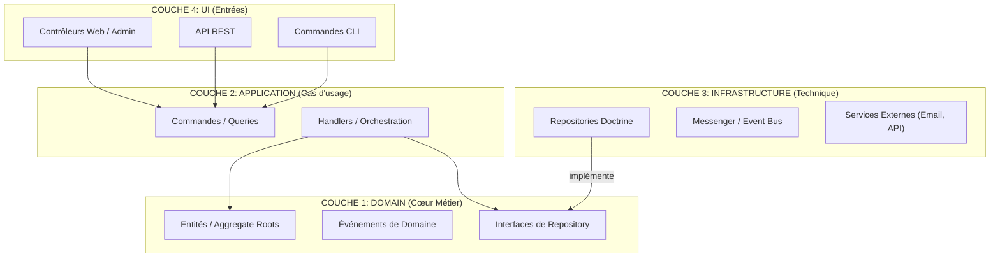

# Symfony Clean Architecture (Hexagonal / DDD)

Bienvenue dans ce projet Symfony structuré selon les principes du **Domain-Driven Design (DDD)** et de l'**Architecture Hexagonale**. L'objectif est de maintenir un cœur métier (Domain) pur, indépendant de toute technologie (Symfony, Doctrine, API).

## 🏗️ Structure de l'Architecture

L'application est divisée en 4 couches principales, suivant la règle de dépendance : **les dépendances pointent toujours vers l'intérieur (le Domaine).**



---

## 📂 Organisation des Dossiers

```text
src/
├── Domain/         # Logique métier pure (Sans Symfony/Doctrine)
├── Application/    # Cas d'usage (Handlers, Commandes)
├── Infrastructure/ # Implémentations techniques (Persistence, Bus)
└── UI/             # Points d'entrée (Http, Cli)
    ├── Http/
    │   ├── Admin/  # Interface d'administration
    │   ├── Public/ # Interface client
    │   └── Rest/   # API REST (Contextuelle)
    └── Cli/        # Commandes console
```

---

## 🛠️ Générateur de Feature

Pour maintenir cette structure sans effort, utilisez le générateur intégré :

```bash
# Générer un domaine complet avec API Admin
php bin/console app:generate:feature MonDomaine --rest=admin

# Générer avec Formulaire et Template Twig
php bin/console app:generate:feature MonDomaine --public --with-form --with-template
```
*Voir [docs/GENERATE_FEATURE.md](docs/GENERATE_FEATURE.md) pour plus de détails.*

---

## 📜 Règles d'Or à Respecter

### 1. Pureté du Domaine
Le dossier `src/Domain` ne doit contenir **aucune** dépendance vers Symfony, Doctrine ou toute bibliothèque tierce.
*   ✅ `namespace Domain\Entity;`
*   ❌ `use Doctrine\ORM\Mapping as ORM;` (Utilisez le mapping YAML/XML dans Infrastructure).

### 2. Interfaces vs Implémentations
Le Domaine définit ses besoins via des **Interfaces** (ex: `UserRepositoryInterface`). L'Infrastructure les réalise (ex: `DoctrineUserRepository`).
*   Le Handler parle à l'Interface.
*   Symfony injecte l'Implémentation via l'autowiring.

### 3. Logique dans l'Entité (Rich Domain Model)
Ne faites pas de "Anemic Domain Model" (entités avec seulement getters/setters).
*   ❌ `$user->setStatus('active');` dans un contrôleur.
*   ✅ `$user->activate();` dans l'entité, qui peut alors enregistrer un événement `UserActivated`.

### 4. Communication par Événements
Pour découpler les fonctionnalités (ex: envoyer un mail après une inscription), utilisez les **Domain Events**.
1.  L'entité enregistre l'événement (`$this->recordEvent(...)`).
2.  Le Handler le récupère et le publie via l' `EventBus`.

### 5. Menu Dynamique
Le projet utilise un système de menu découplé où chaque domaine s'enregistre via un `MenuProvider`.
*Voir [docs/MENU.md](docs/MENU.md) pour plus de détails.*

---

## 🚀 Installation & Développement

1.  **Installation** : `composer install`
2.  **Base de données** : `docker-compose up -d` puis `php bin/console doctrine:migrations:migrate`
3.  **Lancer les tests** : `php bin/phpunit`

---
*Ce document sert de guide de référence pour garantir la maintenabilité à long terme du projet.*
