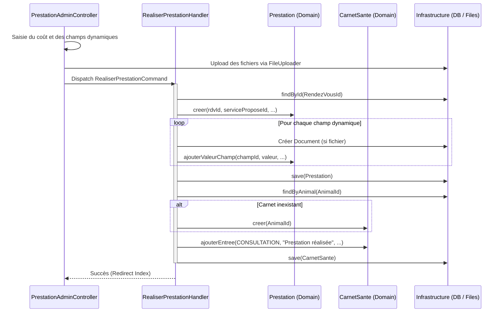

# Feature : Prestations Réalisées & Champs Dynamiques

Cette feature assure le suivi des actes finalisés et permet de collecter des informations spécifiques selon le type de service (vaccination, chirurgie, etc.).

## 🏗️ Architecture du Domaine

### 1. Entité : `Prestation`
Représente l'acte finalisé.
*   **Propriétés** : Rendez-vous (ID), Service Proposé (ID), Date de réalisation, Coût total.
*   **Identifiant** : `PrestationId` (Value Object).

### 2. Entité : `ServiceChamp`
Définit un champ de donnée supplémentaire réutilisable.
*   **Propriétés** : Nom, Type (text, textarea, date, file, etc.), Obligation.

### 3. Entité : `PrestationValeurChamp`
Stocke la valeur saisie pour un champ lors d'une prestation donnée.

### 4. Entité : `Document`
Gère les fichiers uploadés (ordonnances, analyses, photos) liés aux prestations.

---

## 🔄 Flow de Validation

Le processus de validation d'une prestation est une orchestration complexe entre plusieurs domaines. Voici le diagramme de séquence représentant le flow :

### Étapes détaillées :
1.  **Saisie (UI)** : L'utilisateur remplit le formulaire de validation généré dynamiquement à partir des `ServiceChamp` configurés.
2.  **Traitement des fichiers** : Le contrôleur utilise le `FileUploader` pour stocker les fichiers sur le disque avant d'envoyer la commande.
3.  **Exécution (Handler)** :
    *   Le rendez-vous est identifié.
    *   L'agrégat `Prestation` est instancié avec ses valeurs dynamiques.
    *   Si des documents sont présents, ils sont enregistrés dans le domaine `Document`.
4.  **Mise à jour Médicale** : Le handler récupère ou initialise le `CarnetSante` de l'animal pour y consigner l'acte.

---

## 🖥️ Couche UI (Administration)

*   **Validation** : Depuis un rendez-vous, un bouton permet d'accéder au formulaire de validation de prestation.
*   **Champs dynamiques** : Le formulaire génère automatiquement les entrées basées sur les `ServiceChamp` enregistrés.
*   **Upload** : Support complet des fichiers via le service `FileUploader`.

---

## 🔌 Infrastructure

*   **Stockage** : Les fichiers sont stockés dans `public/uploads/` avec une organisation chronologique (`AAAA/MM`).
*   **Persistence** : Mappings XML pour toutes les nouvelles entités.
